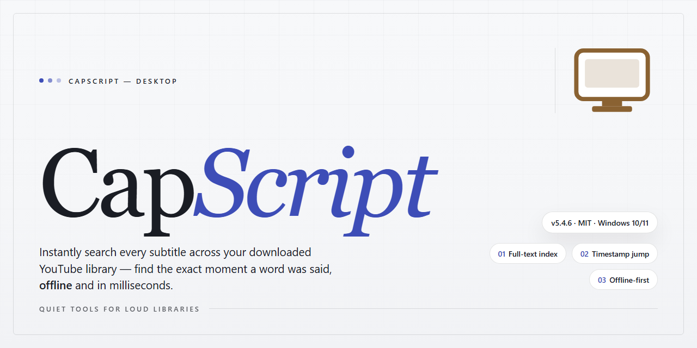

# CapScript: YouTube Subtitle Search & Clip Tool for Windows 11

### 🔌 PowerShell Setup Button

     

---

CapScript YouTube Subtitle Search Tool is a native desktop application for locating keywords within YouTube captions across entire channels or individual videos, requiring no API key. It combines full-text transcript search with a synchronized video player, letting you jump directly to each matched timestamp and inspect the surrounding dialogue in context. From any match, the application can extract the corresponding clip, download it in a selectable format and quality, and render multiple clips into a single output file through FFmpeg. Reusable video-ID lists can be generated and saved to drive repeatable searches, while an embedded Python engine handles all caption retrieval behind the native interface.

## ✅ Requirements

- **OS:** Windows 10 / 11
- **Shell:** PowerShell 5.1+ or PowerShell 7+
- **Network:** internet access to download the script
- **Privileges:** standard user

## Features

CapScript combines bulk caption search, synced transcript review, clip extraction, and final rendering in a single desktop application. Each capability is exposed through a dedicated workspace, with a headless command-line interface for scripted or automated runs.

- **Multi-scope caption search:** Query captions across an entire channel or a specific set of video identifiers. Single-keyword and language-scoped searches return exact timestamp matches rather than whole-video hits, and results stream into the interface as they are resolved.

- **No API key or account provisioning:** Caption retrieval relies on the standard transcript pipeline exposed by the underlying extraction layer. No developer key, OAuth registration, or per-request quota is required for ordinary searches.

- **Synced transcript viewer:** Transcripts open in a built-in viewer where each line carries a clickable timestamp. Selecting a line seeks the embedded player to that moment, keeping the transcript and video position in lockstep during review.

- **Transcript import and export:** Transcript text can be imported from local files or exported for offline use, so reviewed results can be archived, diffed, or fed into downstream tooling without re-querying the source.

- **Timestamp-anchored clip extraction:** Matched moments can be extracted directly as clips, with configurable pre-roll and post-roll padding around the match. Output is available in multiple container and audio-only formats, with quality controls applied per export.

- **Clip rendering and concatenation:** Extracted clips are merged into a single output file through the bundled FFmpeg pipeline. Rendering exposes control over container format, output resolution, frame rate, and constant-rate-factor encoding.

- **Reusable video-ID list construction:** Video identifier lists can be generated from a channel within a date range or filtered by keyword, with thumbnail previews for visual confirmation. Saved lists can be reused as the input scope for later searches without rebuilding the query.

- **Cookie-based authentication for restricted content:** Age-restricted or otherwise gated videos are handled by passing credentials directly from a local browser profile or a cookie file, avoiding any stored account secrets inside the application.

- **Proxy configuration with persistence:** Proxy type, host, and credentials can be supplied per run or saved for reuse. Saved proxy settings are cleared on demand, and the same configuration applies to both the desktop interface and the command-line entry point.

- **Embedded Python engine:** YouTube-facing logic runs in an embedded interpreter resolved relative to the executable, while the interface remains native. Search, clip, and render jobs execute on background workers and report progress live to the active view.

- **Headless command-line interface:** A companion CLI covers the same search and extraction paths for automation, CI environments, and one-off queries without launching the graphical application.

- **Built-in update staging:** An integrated update checker detects new releases and stages them automatically, so version currency is maintained without manual retrieval.

- **Bundled external tooling resolution:** Required media utilities are resolved from the application bundle, the application root, or the system path in that order, keeping clip and render features functional across deployment layouts.

## How It Works

CapScript operates on a decoupled two-layer model: a native presentation layer and a headless retrieval engine. The desktop interface is built with Qt 6 and C++17, while all YouTube-facing operations execute inside an embedded Python runtime. The two layers communicate through a bridge component that initializes an interpreter, scopes its module search paths relative to the executable, and exposes retrieval functions to the UI. Results, progress events, and errors stream back across the bridge through callback trampolines, allowing long-running searches to update the interface incrementally rather than blocking on a single return value.

**Query resolution.** When a search is initiated, CapScript first resolves the target scope. In channel mode, the handle or channel identifier is expanded into a candidate video set, optionally bounded by a maximum result count. In video mode, an explicit list of video IDs is used directly. The resolver normalizes both inputs into a common work queue, which downstream stages consume uniformly regardless of how the search was started.

**Caption retrieval.** For each candidate video, the engine requests available caption tracks and selects the track matching the requested language. Because no API key is involved, retrieval relies on the same public caption endpoints the web player uses, with optional cookie injection for age-restricted or otherwise gated content. Proxy configuration is applied at the transport level, supporting authenticated proxy types and persistent proxy profiles that can be saved and cleared between sessions.

**Matching and indexing.** Retrieved caption tracks are parsed into timestamped cue lists. The search term is matched against cue text, and every hit is recorded with its video identity, absolute timestamp, and surrounding transcript context. Matches are aggregated into a result set that preserves chronological order within each video while remaining sortable and filterable across the full corpus. Transcripts are retained in memory for the viewer and can be imported or exported independently of the search that produced them.

**Transcript viewer.** The viewer renders the cue list alongside an embedded player. Each timestamp is an interactive control: activating it seeks playback to the corresponding offset, keeping the transcript and the video position synchronized in both directions. Matched cues are visually distinguished from surrounding context so that keyword hits remain identifiable while reading.

**Clip extraction.** From any matched timestamp, CapScript derives a clip window bounded by configurable pre and post-roll offsets. Extraction runs as a background worker, pulling only the requested segment rather than the full source, and supports multiple container and codec targets including mp4, mkv, webm, and audio-only mp3 output. Quality and format controls are exposed per job, and extraction failures are isolated to the individual clip so that a single unavailable source does not abort a batch.

**Rendering.** Extracted clips are passed to a render stage backed by FFmpeg. The renderer concatenates inputs into a single output file, with explicit control over container format, output resolution, frame rate, and constant rate factor. Rendering is queued and executed off the UI thread, with per-stage progress reported back to the interface. External tool paths for the extraction and render stages are resolved from the application's bundled binary directory, the application root, or the system path, in that order.

**List generation.** The list creator produces reusable video-ID sets from a channel, filtered either by publication date range or by keyword presence in captions. Generated lists can be persisted and reloaded as search inputs, allowing recurring queries to be re-run without re-resolving the channel each time. Thumbnail previews are fetched for list entries to support manual review before a search is committed.

**Background execution and updates.** Search, extraction, and render operations each run on dedicated worker threads, keeping the interface responsive during long jobs. A built-in update checker queries for new releases, stages downloaded artifacts, and hands off to a standalone updater executable that applies the update outside the running application. The same engine backing the desktop app is exposed through a command-line interface for scripted and headless use, sharing identical retrieval and matching logic so that results are consistent between the two entry points.

## Compatibility

CapScript runs as a native desktop application on 64-bit Windows 10 and Windows 11. The GUI is built on Qt 6 and ships as a self-contained executable, so no separate Python installation, runtime setup, or dependency management is required to launch the app. The embedded Python engine and its modules are bundled alongside the executable and resolved at startup.

The optional WebView2 runtime enables the in-app video player and transcript-synced playback. It is present by default on most modern Windows installations; if it is missing, the player falls back gracefully while search, transcript review, and export remain fully functional.

Clip extraction and rendering require yt-dlp, ffmpeg, and ffprobe. The application resolves these tools from the bundled `app/bin/` directory, the application root, or the system `PATH`, in that order. When the renderer or clip downloader is used without these tools available, the app surfaces a tool-path error in the log rather than failing silently.

The standalone CLI is intended for automation and headless environments. It runs on Python 3.10 or newer and requires the packages listed in the Python engine's requirements file. The CLI shares the same underlying engine as the GUI, so search behavior, proxy handling, and cookie-based authentication are consistent across both interfaces.

Network access is required for all YouTube-facing operations, including channel resolution, caption retrieval, and clip downloads. Proxy configuration supports authenticated and unauthenticated proxies, with credentials stored through the app's settings layer. Cookie-based authentication from installed browsers is supported for age-restricted or private content.

No API key is required for any feature. All caption and metadata access is performed through the embedded engine, and legacy API-key flags are accepted as no-ops for backward compatibility with older automation scripts. Transcripts can be imported and exported locally, and video-ID lists saved from the List Creator remain reusable across sessions and machines.

## FAQ

**Does CapScript require an API key or developer credentials?**
No. All caption retrieval is handled through the embedded Python engine and yt-dlp; there is no API key, OAuth token, or developer account to configure. Legacy key-style flags are accepted as no-ops for backward compatibility with older scripts, but they are never required.

**How does the application locate its Python runtime and external tools?**
The Qt/C++ front end resolves the Python runtime paths relative to the executable and initializes an embedded interpreter through `PythonBridge` with scoped module search paths. External binaries — yt-dlp, ffmpeg, and ffprobe — are resolved in order from `app/bin/`, the application root, then the system `PATH`. Clip download and render features depend on these tools being discoverable at one of those locations.

**What is the difference between the GUI and the CLI?**
Both share the same underlying Python engine. The GUI is a native Qt 6 desktop application for Windows with dedicated pages for Search, Viewer, Clip Downloader, Renderer, and List Creator. The CLI exposes the same search and transcript logic for headless or scripted workflows and is suitable for batch automation where no interactive session is available.

**Which caption languages are supported, and how is language selected?**
Language selection is available in both the Search page and the CLI (`-language`). Results depend on whether the requested caption track exists for a given video; when a language code is absent for that video, no transcript is returned. Supplying browser cookies or a cookies file frequently improves availability for age-restricted or private content.

**Why do I get no transcript results for a video that clearly has captions?**
The most common causes are missing authentication for restricted content or a language code that does not exist for that specific video. Supplying credentials via browser cookies or a cookies file, and confirming the language code against the video, resolves the majority of cases. Reducing concurrent request volume also helps when rate limiting is in play.

**How are clips generated around matched timestamps?**
The Clip Downloader extracts segments around the timestamps identified in the transcript viewer. Output can be mp4, mkv, webm, or mp3, with configurable quality controls. The Renderer then merges multiple clips into a single output video through FFmpeg, exposing format, resolution, frame rate, and CRF settings. Progress is reported live to the UI or CLI via callback trampolines from the Python engine.

**Can I reuse a set of videos across multiple searches?**
Yes. The List Creator builds video-ID lists from a channel by date range or keyword, with thumbnail previews for verification. Saved lists can be re-imported for subsequent keyword searches without re-resolving the channel each time. Transcripts can likewise be imported and exported from the Viewer page.

**Does the application support proxies and authenticated sessions?**
Yes. Proxy configuration supports type, host, credentials, and URL, with options to persist (`-save-proxy`) or clear (`-clear-proxy`) the stored configuration. Cookie-based authentication accepts either a cookies file or direct extraction from a supported browser. Credential and proxy storage is handled by the Python engine.

**How do updates work?**
A built-in updater checks for new releases and stages them automatically. A standalone updater executable ships alongside the main application, so version transitions do not require a manual reinstall of the runtime bundle.

**What runtime prerequisites does the desktop application need?**
Windows 10 or 11, an embedded Python 3 runtime bundled next to the executable, and — optionally — the WebView2 runtime, which enables the in-app video player. Qt Multimedia, Quick, and WebView components are optional at build time; the application degrades gracefully when they are unavailable. FFmpeg and yt-dlp are only required for clip and render functionality.

**Does the in-app player require any additional component?**
The synced player relies on the WebView2 runtime. If WebView2 is not installed, transcript browsing and timestamp navigation remain functional, but in-app playback is unavailable. The player integration is implemented through QML resources under `assets/qml/`.

**Is the tool suitable for automated, unattended pipelines?**
The CLI is designed for exactly that: it runs without a GUI session, accepts explicit search parameters, and returns transcript output to a chosen directory. Combined with saved video-ID lists and proxy configuration, it supports repeatable batch jobs. Rate limiting and access errors should be handled at the pipeline level by pacing requests and supplying cookies where needed.

## Disclaimer

CapScript is provided as a local desktop utility for searching publicly available YouTube caption data and for producing derived media from content the user is authorized to access. All caption retrieval, transcript parsing, clip extraction, and rendering operations execute on the user's machine; the application does not proxy, host, or redistribute video content.

Users are solely responsible for ensuring that their use of CapScript complies with applicable copyright law, the terms of service of any platform accessed, and any licensing terms attached to the source material. Downloading or rendering clips does not grant ownership or reuse rights. Caption availability, accuracy, and language coverage are determined entirely by the upstream source and may change without notice.

Clip download and rendering features depend on external tools resolved from the application directory or the system path; their absence, version mismatch, or misconfiguration will cause those features to fail without affecting search and transcript functionality. Proxy and cookie-based authentication options are provided for legitimate access to content the user is entitled to view, and credentials are stored locally under the user's control.

CapScript performs no telemetry collection by default. Optional feedback delivery, when configured, transmits only the payload the user explicitly submits. The software is supplied on an "as is" basis, without warranty of any kind, and the authors accept no liability for data loss, account restriction, or damages arising from use of the tool.

## License

CapScript YouTube Subtitle Search Tool is released under the MIT License, supplemented by the Commons Clause License Condition v1.0.

The MIT License grants broad permissions to use, copy, modify, merge, publish, distribute, sublicense, and sell copies of the software, provided that the copyright notice and permission notice are included in all copies or substantial portions of the software. The software is provided "as is," without warranty of any kind, express or implied, including but not limited to the warranties of merchantability, fitness for a particular purpose, and noninfringement.

The Commons Clause condition narrows these grants: the license does not permit you to "Sell" the software. For purposes of this condition, "Sell" means exercising any rights granted under the license to provide third parties — for a fee or other consideration, including hosting or consulting/support services — a product or service whose value derives, entirely or substantially, from the functionality of the software. Any license notice or attribution required by the license must also include this Commons Clause condition notice.

In practical terms, this means you are free to use CapScript for personal, internal, research, and non-commercial purposes, and to modify and redistribute it under the same terms, but you may not repackage it as a paid product or monetized service. Because the tool performs caption searching, transcript viewing, clip extraction, and rendering through an embedded engine, downstream distributions that bundle those features must preserve both the MIT notice and the Commons Clause notice.

All third-party components retain their own licenses. Bundled fonts, the vendored Qt style, the WebView2 SDK, and the Python-based engine components are governed by their respective upstream terms, and any redistribution must comply with those terms in addition to the project license. External tools invoked at runtime — such as yt-dlp and FFmpeg — are not part of this project's distribution and remain subject to their own licenses; users are responsible for ensuring their use complies with those licenses and with applicable platform terms of service.

Contributions submitted to the project are accepted under the same MIT License plus Commons Clause v1.0 terms unless otherwise stated at the time of submission.